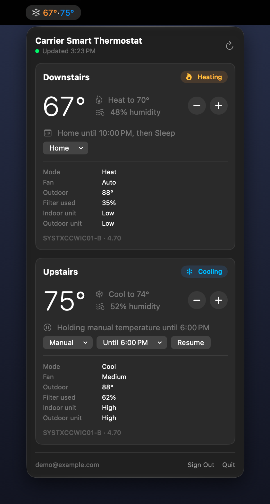

# CarrierBar

A macOS menu bar app that shows the current temperature of each Carrier unit on your account. Clicking it opens a panel with details for each unit, where you can also change the temperature, mode, and fan, hold a comfort profile, and go back to the schedule.

<p align="center">
  
</p>

> CarrierBar is an independent project. It is not affiliated with, endorsed by, or supported by Carrier. It talks to the same private cloud API as Carrier's own apps, which can change at any time. Use it only with your own account. See [Disclaimer](#disclaimer).

## Requirements

- macOS 14 or later
- Xcode 16 or later (the project uses synchronized folders, a project format introduced in Xcode 16)
- The Carrier account you use in the Carrier SmartHome app

## Download notarized build
If you don't want to build the app locally, you can download the latest notarized release build and simply run and use it on your macOS.
-  Download in [Releases](https://github.com/cetorres/carrier-ac-control/releases).

## Build and run locally

1. Open `CarrierBar.xcodeproj`.
2. Optional: to sign with your own Apple developer team, create `Config/Signing.local.xcconfig` with `DEVELOPMENT_TEAM = <your team ID>`, and if you like `PRODUCT_BUNDLE_IDENTIFIER = <your bundle ID>`. Git ignores this file. Without it the app signs to run locally, and macOS asks you to allow Keychain access again after each rebuild, because the ad hoc signature changes every time. Set signing this way rather than in the Signing & Capabilities tab, which writes your team ID into the shared project file.
3. Press Run. A snowflake appears in the menu bar. Click it, sign in, and after the first fetch your temperatures appear next to it.

The `CarrierBar` folder is synchronized with the project, so files you add, rename, or delete there in Finder show up in Xcode automatically.

### Demo mode

Choose the **CarrierBar Demo** scheme to run with two made-up units and no account. It passes the launch argument `-DemoMode YES`. Demo mode never touches your saved session and makes no network requests, which makes it handy for screenshots and for trying the interface.

To refresh the screenshot above, run the demo scheme, then run this from the repository root and click the snowflake before the countdown ends:

```bash
swift Design/Screenshots/capture.swift
```

It captures only the menu bar item and the open panel, places them on a clean background, and saves `Design/Screenshots/panel.png`. Terminal needs Screen Recording permission the first time.

## Signing in

The sign in panel offers three ways in.

**Web.** Opens my.carrier.com in a CarrierBar window. Sign in there and the window picks up the portal's session and closes by itself. The window has its own cookies and storage, so it doesn't see a sign in from Safari or Chrome.

**Token.** Reuses the session from a browser that's already signed in to my.carrier.com. On that page, open the JavaScript console and run:

```js
copy(localStorage.getItem('AUTH_DATA--1'))
```

Then paste into CarrierBar (the panel has a Paste from Clipboard button) and click Use Session. That entry holds both the access token and the refresh token, so CarrierBar can keep the session alive on its own. Close the browser tab afterwards without signing out, so the browser and CarrierBar don't take turns renewing the same session.

The field also accepts a bare access token, `Bearer …`, or a whole `Authorization` header. Without a refresh token the session lasts only until that token expires (30 minutes), and then CarrierBar asks you to sign in again.

In Safari, the console needs the Develop menu: Settings › Advanced › Show features for web developers. In Chrome it's View › Developer › JavaScript Console, and Chrome may ask you to type `allow pasting` before it accepts a pasted command.

**Password.** Your Carrier account email and password, sent once to `assistedLogin` and never stored.

## Changing settings

Changes made in the panel go to your real thermostats, the same as changes made in the Carrier app. The panel shows a change right away and keeps showing it until Carrier reports it back, which can take a few seconds.

**Temperature.** The − and + buttons next to a unit move the setpoint its mode uses by one degree. In auto, both setpoints move together. Several quick clicks are sent as one change once you pause. A change holds the new temperature:

- If the unit is already on a hold, the hold keeps its end time. A Smart Thermostat restarts its countdown with each change, so CarrierBar sends the time that's left, rounded up to whole hours.
- If an Infinity zone is following its schedule, the hold lasts until the next scheduled change, as it does when you change the temperature on the thermostat itself.
- If a Smart Thermostat is following its schedule, the hold lasts until you change it.

**Comfort profiles and schedule.** A unit with comfort profiles (Home, Away, Sleep, Wake) or a weekly schedule gets a schedule row under its temperature. The row says what the unit is doing, for example "Wake until 10:30 PM, then Sleep" or "Holding Away until 6:00 PM". From the row you can:

- **Hold a profile.** The profile menu lists each profile with its temperatures and checks the current one. Profiles that aren't set up on the thermostat don't appear.
- **Choose when the hold ends.** For 1, 2, 4, or 8 hours, or until you change it. Infinity zones also offer until the next scheduled change and until a time you pick. Infinity holds end on a quarter hour, so picked times are rounded to the nearest 15 minutes.
- **Resume.** Ends the hold, and the unit follows its schedule again.

**Mode and fan.** The row under the schedule has a Mode menu (Off, Heat, Cool, Auto, and on Infinity, Fan Only) and a Fan menu. Smart Thermostats offer Auto, On, and Circulate, like the Carrier app. Infinity offers Auto, Low, Medium, and High. On Infinity the mode belongs to the whole system, so every zone changes with it, and the fan setting belongs to the activity the zone is in now. Changing either one leaves the temperature, schedule, and hold as they are.

Schedule and hold times are shown in the thermostat's time zone, as reported by the system, even if your Mac is somewhere else.

## Settings

The gear at the bottom of the panel opens a menu with Settings, About, Sign Out, and Quit. Settings has two tabs:

- **General.** Launch at login, and the account you're signed in with. If macOS asks you to approve the login item, the tab links to System Settings › General › Login Items.
- **About.** Version, links, and the disclaimer.

## How it works

**Sessions.** my.carrier.com keeps its session in localStorage under `AUTH_DATA--1`, in the same shape `assistedLogin` returns: a 30 minute access token and a refresh token, both issued by Carrier's Okta (`sso.carrier.com`) to the same client the Carrier apps use. Whichever way you sign in, CarrierBar keeps one Keychain item with the account email (read from the token's `sub` claim for web sessions), the tokens, and the token's expiry. Refresh tokens are only ever sent to `sso.carrier.com`.

**Tokens.** Access tokens are renewed through Carrier's Okta token endpoint about a minute before they expire. If Okta rotates the refresh token, the new one replaces the old one in the Keychain. If renewal is rejected, the app signs out and asks you to sign in again.

**Data.** The app runs both the `infinitySystems` and `entryLevelSystems` queries, so it works whether your units are Infinity systems or Carrier Smart Thermostats. Each enabled zone becomes one entry in the menu bar and the panel, sorted by name. The same queries bring in each zone's comfort profiles, weekly schedule, and hold, so the schedule row needs no extra requests.

**Controls on Infinity systems.** Infinity holds a zone in an activity. A temperature change writes the `manual` activity's setpoints with `updateInfinityZoneActivity`, then holds the zone in it with `updateInfinityZoneConfig`. Holding a profile is the same `updateInfinityZoneConfig` call, with that profile as the activity. The hold's end goes in `otmr` as a time of day ("HH:MM", the system's time), or `null` to hold until changed. Resume sets `hold` to `off`. The Infinity controls follow [carrier_api](https://github.com/dahlb/carrier_api) and haven't been tried on a real Infinity system yet.

**Controls on Smart Thermostats.** Everything goes through `updateEntryLevelZone`, which takes both setpoints together. A timed hold sends its length in whole hours as `hold_end_time` and leaves `schedule_enabled` on. A hold until changed turns `schedule_enabled` off. Smart Thermostats have no way to switch to a scene, so holding a profile holds that profile's setpoints, and the panel names the hold after the profile whose setpoints match. Resume turns the schedule back on and sends the setpoints of the profile the schedule calls for. While a timed hold runs, Carrier reports the minutes left in `hold_countdown`. A mode or fan change sends only `mode` or `fan_mode` with the zone's serial and index, so nothing else changes. Smart Thermostats report `mode` and `fan_mode` in lowercase (`cool`, `auto`). The fan values `on` and `circulate` follow that pattern but haven't been confirmed against a real unit yet.

**Mode and fan on Infinity systems.** The mode goes through `updateInfinityConfig`, which sets it for the whole system. The fan goes through `updateInfinityZoneActivity` on the zone's current activity, as in carrier_api.

**Live updates.** The app keeps Carrier's realtime websocket open. Status messages (temperature, humidity, setpoints, cooling or heating state) are merged into the current data right away. Other messages trigger one debounced refetch. A full fetch also runs every 5 minutes as a safety net, every minute while the websocket is down, and whenever the panel opens with data older than a minute. Waking from sleep reconnects and refreshes.

**Tolerant decoding.** Carrier mixes `"74"`, `74`, `"on"`, and `"None"` for similar fields. Every scalar goes through `JSONScalar`, so one odd value never breaks a whole response.

## Project layout

| Path | What it holds |
| --- | --- |
| `App/CarrierBarApp.swift` | `MenuBarExtra` scene with the window style panel |
| `App/ThermostatStore.swift` | Observable state: session, thermostats, refresh, realtime, polling, and changes waiting for Carrier to confirm them |
| `App/AppSettings.swift` | Launch at login with `SMAppService`, and the About tab's details |
| `App/WebSignInWindowController.swift` | my.carrier.com window that picks up the portal's session |
| `Carrier/CarrierClient.swift` | Actor that signs in, imports web sessions, renews tokens, runs GraphQL queries, and sends setpoint, hold, resume, mode, and fan changes |
| `Carrier/TokenImport.swift` | Reads pasted sessions, headers, and tokens |
| `Carrier/JWTClaims.swift` | Account, expiry, client, and issuer from an access token |
| `Carrier/RealtimeListener.swift` | Websocket connection, keepalive, reconnect with backoff, message parsing |
| `Carrier/CarrierDTOs.swift` | Wire formats for responses and realtime patches |
| `Carrier/CarrierQueries.swift` | GraphQL queries and mutations |
| `Model/Thermostat.swift` | One normalized unit, mapping from both system types, realtime merge, setpoint steps |
| `Model/Schedule.swift` | Comfort profiles, weekly schedule, and hold lengths, with the schedule math in the thermostat's time zone |
| `Model/DemoData.swift` | Made-up units for demo mode |
| `Support/KeychainStore.swift` | Session persistence |
| `Views/` | Menu bar label, panel and its gear menu, unit card with − and + buttons, schedule row, mode and fan row, Settings window, sign in, web sign in window |

Build settings worth knowing: the Info.plist is generated from build settings (`LSUIElement` is on, so there is no Dock icon), the app is sandboxed with outgoing network access only, the language mode is Swift 5 with minimal concurrency checking, and the default bundle ID is `com.cetorres.CarrierBar`. Signing and the bundle ID come from `Config/Signing.xcconfig`, which a git-ignored `Config/Signing.local.xcconfig` can override.

## App icon

The icon lives in `CarrierBar/Assets.xcassets/AppIcon.appiconset`, with every macOS size from 16 to 1024 px. The 16 and 32 px images use a simpler drawing with bolder strokes so they stay legible.

Sources are in `Design/AppIcon`: the full icon as SVG and a 1024 px PNG, plus `layers/` with the background and glyph as separate, unmasked files for Icon Composer if you want a Liquid Glass version for macOS 26. To change colors or proportions, edit `make_icon.py` and run `python3 make_icon.py <output folder>` (it needs Playwright for Python).

## Debugging

Open Console.app and filter by the subsystem `com.cetorres.CarrierBar`. The `api` category logs HTTP and decoding problems. The `realtime` category logs every websocket message at debug level (turn on Action › Include Debug Messages), which is the easiest way to see what Carrier pushes when you change something in the iPhone app.

If the panel says Carrier sent a response this app couldn't read, the `api` log shows the exact decoding error.

Before attaching logs to an issue, remove serial numbers and account details. Websocket messages include your system's serial number. CarrierBar never logs passwords or tokens.

## Security

- Passwords are sent once to Carrier's sign in mutation and never stored.
- Tokens live in a single item in your login Keychain, never in files or `UserDefaults`.
- Refresh tokens are only sent to Carrier's authorization server, `sso.carrier.com`.
- The app is sandboxed, with outgoing network access as its only entitlement.
- The Okta client ID in `CarrierClient.swift` is the public identifier Carrier's own apps use. It is not a secret, and there is no client secret.

Please report security problems through GitHub's private vulnerability reporting rather than in a public issue.

## Roadmap

- Edit the weekly schedule and each profile's temperatures, using `updateEntryLevelSchedule` and `updateEntryLevelComfortProfile` on Smart Thermostats
- Show a short name or icon next to each temperature in the menu bar, or choose which unit appears there

## Acknowledgments

The GraphQL operations, authentication flow, and realtime protocol follow [carrier_api](https://github.com/dahlb/carrier_api) by Bren Dahl, an MIT licensed Python client that also powers the [ha_carrier](https://github.com/dahlb/ha_carrier) Home Assistant integration.

## License

MIT. See [LICENSE](LICENSE).

## Disclaimer

CarrierBar is an independent, unofficial project. It is not affiliated with, endorsed by, sponsored by, or supported by Carrier Global Corporation or its subsidiaries. Carrier, Infinity, and other product names are trademarks of their respective owners and are used here only to describe compatibility.

CarrierBar uses Carrier's private cloud API, which is undocumented and can change or stop working at any time. Use it only with your own account and at your own risk. The software is provided as is, without warranty of any kind.
